# How’s the Weather

**出門前看一眼：會下雨嗎？等一下再走會不會比較好？**

一款為台灣日常設計的 Android 天氣 App。畫面上方先用一句話給你結論，下方則備妥雷達、累積雨量與衛星雲圖供你查證。資料取自中央氣象署與環境部開放資料。

https://github.com/user-attachments/assets/995311ea-d588-492f-b4b3-08c37ed928ee

<table>
  <tr>
    <td width="33.33%" align="center">
      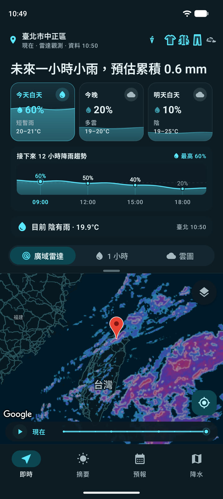<br>
      <sub><b>先看結論</b><br>一句白話，搭配逐時降雨趨勢</sub>
    </td>
    <td width="33.33%" align="center">
      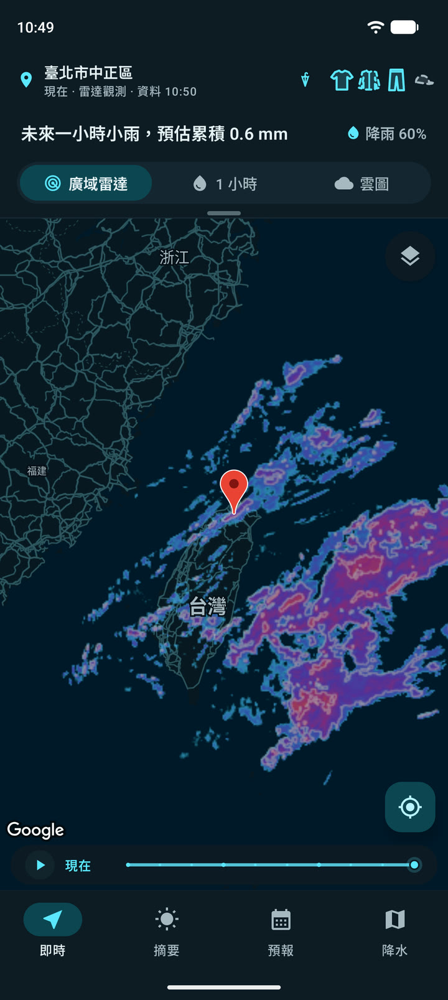<br>
      <sub><b>再看根據</b><br>雷達、雨量、雲圖，隨手切換</sub>
    </td>
    <td width="33.33%" align="center">
      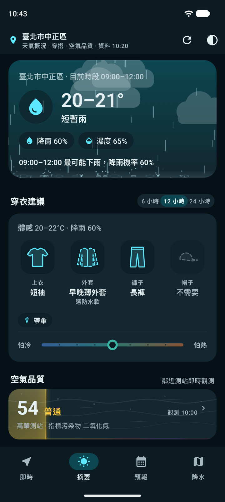<br>
      <sub><b>出門準備</b><br>穿衣建議與即時空氣品質</sub>
    </td>
  </tr>
</table>

Kotlin · Jetpack Compose · Material 3 · Google Maps / OpenStreetMap · 中央氣象署 & 環境部開放資料

## 設計理念

**結論在前，證據在後。** 不必先讀懂雷達色階，才知道該不該帶傘。畫面第一行永遠是一句清楚的判斷，例如「未來一小時小雨，預估累積 0.6 mm」；想看雨帶怎麼走，再往下對照地圖。

**有多少根據，說多少話。** 地圖可以放大到街廓與建築，但氣象資料並沒有那麼高的解析度。氣象署的一小時預報本質上是「未來一小時的累積雨量格點」，因此 App 只如實呈現預估累積量，不憑空捏造「12 分鐘後開始下雨」這類沒有資料支撐的細節。

**讀數值，不貼現成圖片。** 雷達與雨量圖層直接解析官方數值格點，以一致的色階重新渲染並描繪等值線，不直接套用氣象署網站預先上好彩虹色階的圖檔。缺測值維持透明，絕不當作無雨處理。

**克制而安定的視覺。** 深色主題以深海軍藍襯托冷青色重點；淺色主題則以溫潤的米白搭配深青色。兩種主題共用同一套物理量門檻與色相語意，不啟用 Material You 動態配色，讓天氣色階的意義保持固定，不隨手機桌布改變。

## 功能

### 即時：一句結論 + 一張地圖

<table>
  <tr>
    <td width="33.33%" align="center">
      <br>
      <sub>展開：今晚、明日重點與 12 小時趨勢</sub>
    </td>
    <td width="33.33%" align="center">
      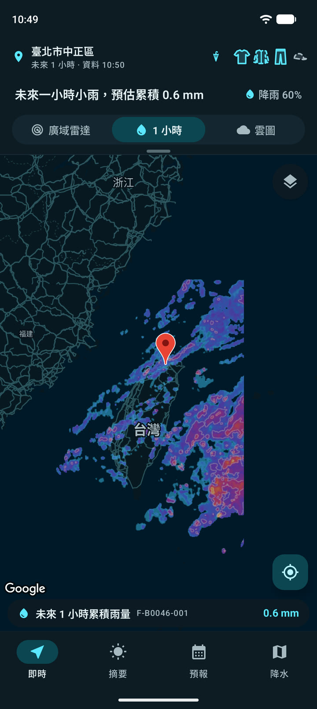<br>
      <sub>未來 1 小時累積雨量</sub>
    </td>
    <td width="33.33%" align="center">
      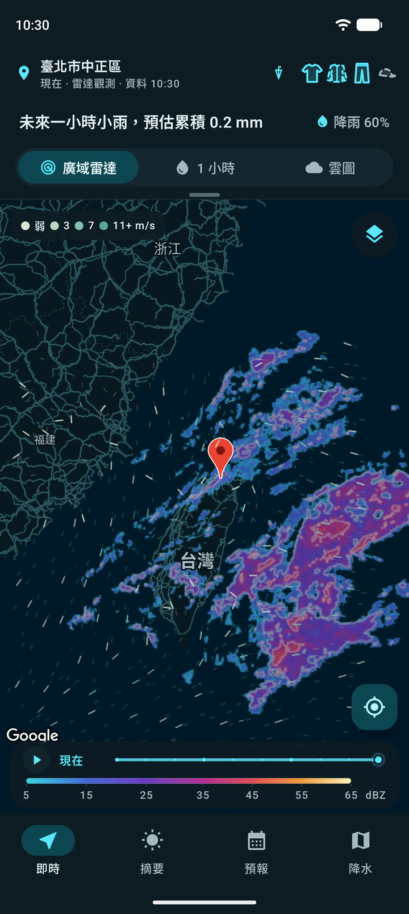<br>
      <sub>疊加風場粒子與圖例</sub>
    </td>
  </tr>
</table>

- **三段式上下分割**：拖曳分割線，即可在「完整摘要」、「三張重點預報卡」與「單行結論」之間連續調整高度。緩慢放開會吸附至最近的段落；快速滑動則會依手勢速度順勢跳段並回彈定位。
- **分割線即圖層軌**：在分割線上點選或左右滑動，即可切換 `廣域/區域雷達`、`1 小時`、`雲圖`。雷達圖層會隨地圖縮放倍率，自動銜接廣域與局部觀測資料。
- **過去 90 分鐘雷達回放**：時間軸以 10 分鐘為一格，可手動拖曳或直接播放，觀察雨帶移動方向。
- **選配疊加圖層**：可獨立開啟**風場粒子**與**色階圖例**；當氣象署發布熱帶氣旋資料時，會多出**颱風圖層**開關，開啟後繪出分析路徑、預報路徑、70% 機率範圍，以及七級、十級暴風半徑。
- **地點選擇**：未授權定位時預設為台北，授權後自動採用目前位置；**長按地圖**任意處即可查看該點的天氣與判斷。

### 摘要：天氣、穿搭、空氣品質

<table>
  <tr>
    <td width="50%" align="center">
      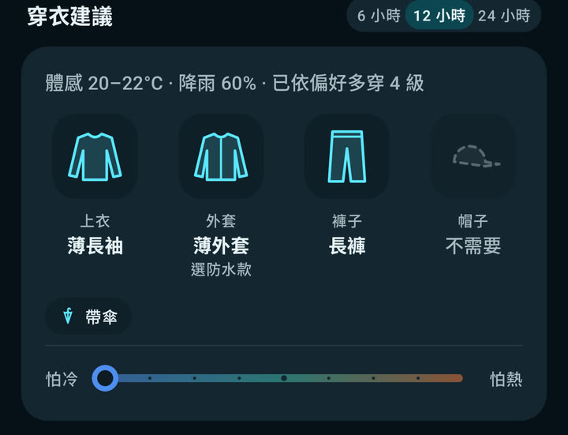<br>
      <sub>偏好「怕冷」：薄長袖＋薄外套</sub>
    </td>
    <td width="50%" align="center">
      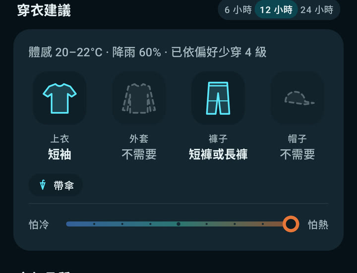<br>
      <sub>偏好「怕熱」：短袖即可</sub>
    </td>
  </tr>
</table>

- **穿衣建議**：根據鄉鎮預報的體感溫度、降雨機率、相對濕度、風速與日間紫外線，分別建議上衣、外套、長短褲與帽款，並可切換未來 6、12 或 24 小時的時間窗。
- **體感偏好滑桿**：在**怕冷 ↔ 怕熱**之間調整個人體質，建議會即時連動。考量低溫時每個人的耐寒差異更大，氣溫越低，每格滑桿對應的溫度修正幅度也越大。
- **濕冷與雨具提醒**：降雨機率偏高時會提示**帶傘**；遇到低溫且高濕度的濕冷天氣，則會自動調高保暖建議。
- **空氣品質**：卡片顯示鄰近測站的即時 AQI，點開可查看全台測站分布與空間內插後的連續色階地圖。

### 預報與降水

<table>
  <tr>
    <td width="33.33%" align="center">
      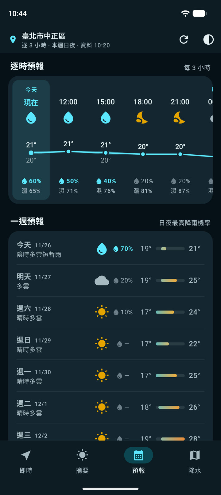<br>
      <sub>逐 3 小時與一週日夜預報</sub>
    </td>
    <td width="33.33%" align="center">
      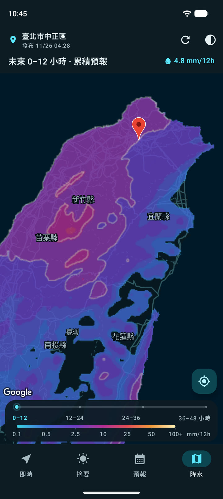<br>
      <sub>0–48 小時定量降水預報（每 12 小時一段）</sub>
    </td>
    <td width="33.33%" align="center">
      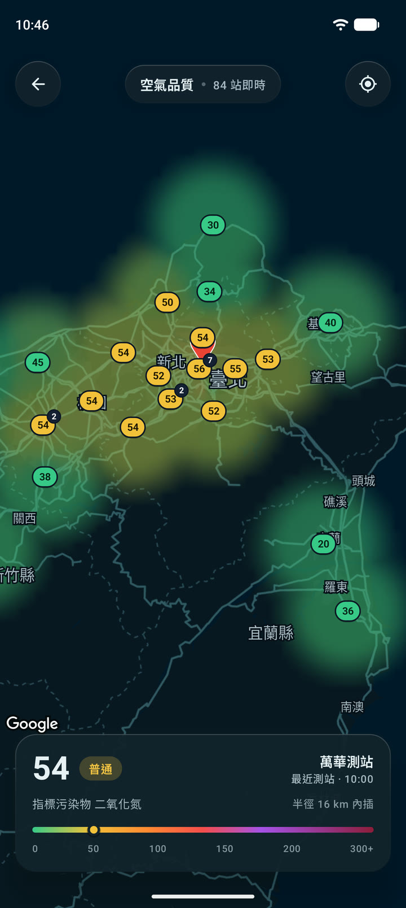<br>
      <sub>全台空氣品質地圖</sub>
    </td>
  </tr>
</table>

### 淺色主題

<table>
  <tr>
    <td width="33.33%" align="center">
      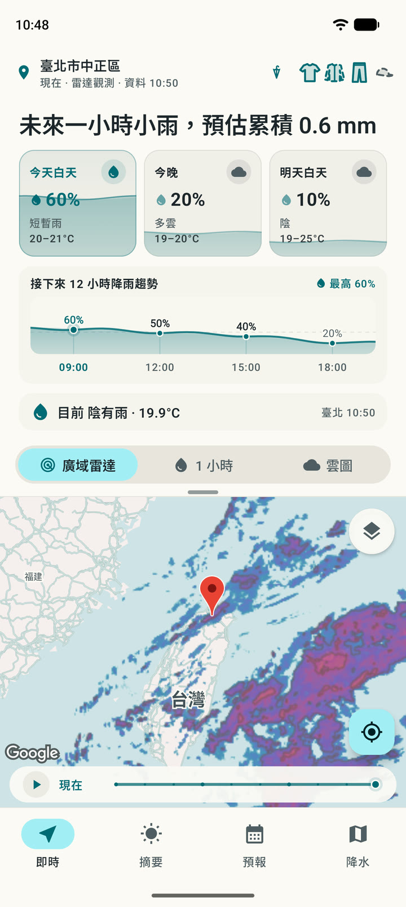
    </td>
    <td width="33.33%" align="center">
      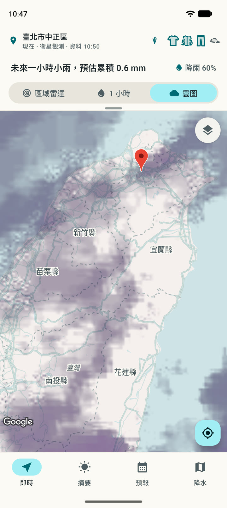
    </td>
    <td width="33.33%" align="center">
      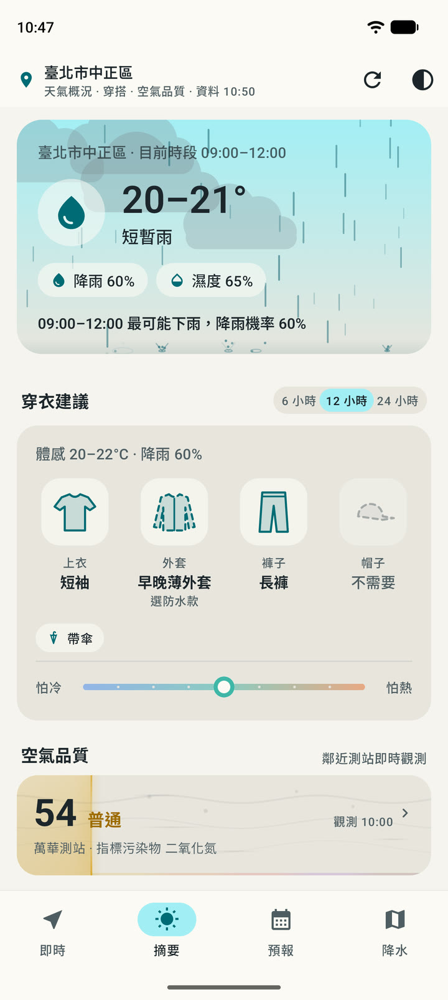
    </td>
  </tr>
</table>

可跟隨系統設定，或在摘要頁右上角手動切換深淺主題。

### 桌面小工具

將小工具放到主畫面，不必打開 App 就能查看時間、目前天氣與降雨摘要，下方並整合 Google 搜尋列與媒體音量滑桿。

## 建置與執行

1. 將 `local.properties.example` 複製為 `local.properties`，保留原本的 `sdk.dir`。
2. 填入以下金鑰：
   - `MAPS_API_KEY`：Google Maps SDK 金鑰。
   - `MAP_ID`：選填，啟用 Google Cloud Styling 時使用。
   - `CWA_API_KEY`：中央氣象署開放資料金鑰。
   - `MOENV_API_KEY`：選填，環境部空氣品質資料金鑰。
3. 以 Android Studio 開啟專案並執行 `app`。

若未設定 `CWA_API_KEY` 或連線失敗，App 會退回內建的示範格點資料，並在畫面上明確標示目前並非官方即時資料。

> `CWA_API_KEY` 在編譯時會封裝進 APK，可被反編譯還原。若要公開上架，請改由後端代理轉發 API 請求。

### 底圖供應商切換

底圖於建置階段決定，App 內不提供動態切換。修改 `local.properties` 後重新建置即可：

```properties
MAP_PROVIDER=google   # 預設，需要 MAPS_API_KEY
MAP_PROVIDER=osm      # OpenStreetMap（osmdroid），不需金鑰
```

`osm` 模式預設採用 CARTO Positron（淺色）與 Dark Matter（深色）圖磚，隨主題切換。你也可以透過 `OSM_TILE_URL_LIGHT`、`OSM_TILE_URL_DARK` 指定其他 `{z}/{x}/{y}` 圖磚網址（支援 `{s}` 代表 a–d 子網域、`{r}` 代表 `@2x`），並以 `OSM_TILE_ATTRIBUTION` 設定對應的版權標示（`local.properties` 採用 ISO-8859-1 編碼，`©` 等非 ASCII 字元請寫為 `\u00A9`）。請注意 CARTO 免費圖磚僅限非商業用途。

## 資料來源

| 代碼 | 內容 |
| --- | --- |
| `F-B0046-001` | 未來一小時累積雨量格點（降雨決策卡依據） |
| `O-A0058-005` / `O-A0058-006` | 雷達回波（大範圍／局部） |
| `F-C0035-015` / `-017` / `-023` / `-024` | 0–48 小時定量降水預報，每 12 小時一段 |
| `O-B0032-003` / `O-C0042-004` | 紅外線衛星雲圖（東亞 1200×1200／台灣 800×800，僅載入最新觀測） |
| `O-A0001-001` / `O-A0003-001` | 地面測站觀測與目前天氣 |
| `M-A0064-000` | 數值模式風場（開啟風場圖層時才載入） |
| `F-D0047-*` | 鄉鎮未來三天與一週天氣預報 |
| `W-C0034-005` | 熱帶氣旋分析與預報路徑、暴風半徑、70% 機率範圍 |
| `AQX_P_432` | 環境部空氣品質測站觀測 |

App 僅在前景開啟時請求資料，不在背景常駐輪詢。檔案型資料透過 HTTP 快取（ETag / Last-Modified）重新驗證；API 型資料則依各產品發布週期設定本地快取時效。

## 專案結構

- `domain/`：天氣格點取樣、降雨決策、穿衣建議等核心邏輯，不依賴 Android 與 Compose
- `data/`：網路請求、快取策略與資料格式解析
- `render/`：地圖圖磚渲染、OKLab 色階內插與等值線繪製
- `ui/`：主畫面、可拖曳面板、底圖封裝與各功能分頁
- `widget/`：桌面小工具

## 測試與驗證

```powershell
$env:JAVA_HOME='C:\Program Files\Android\Android Studio\jbr'
./gradlew.bat :app:testDebugUnitTest :app:assembleDebug :app:lintDebug --console=plain
```

macOS：

```sh
JAVA_HOME="/Applications/Android Studio.app/Contents/jbr/Contents/Home" \
  ./gradlew :app:testDebugUnitTest :app:assembleDebug :app:lintDebug --console=plain
```
